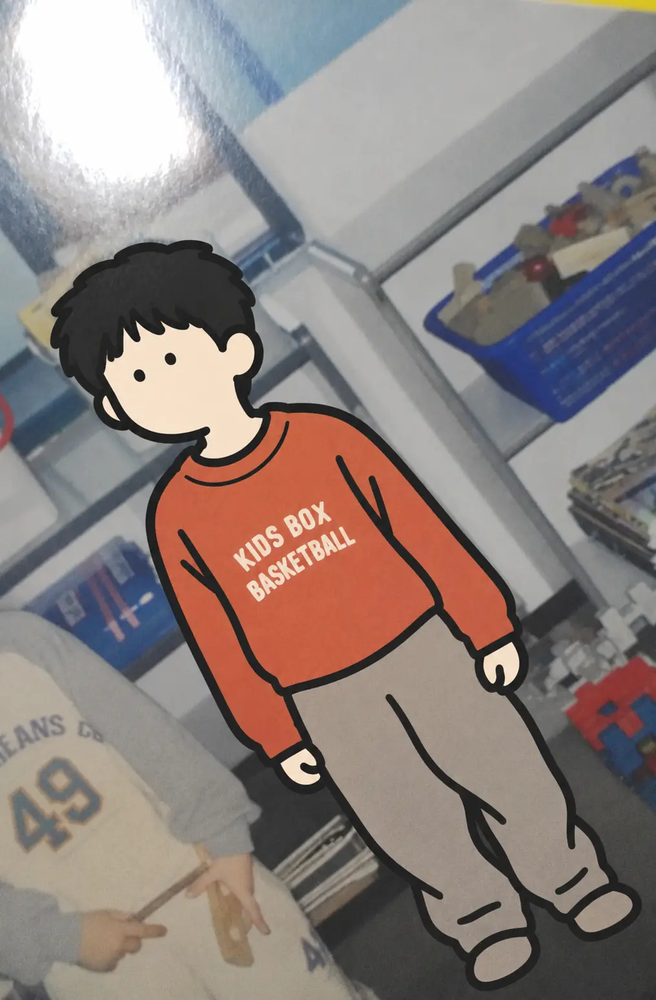
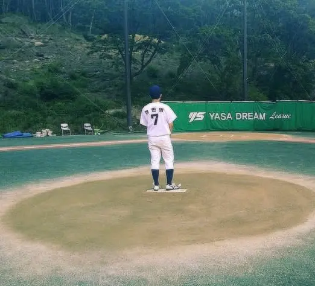
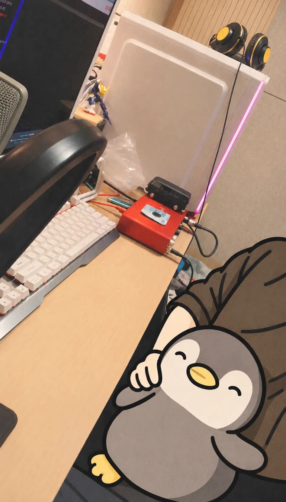
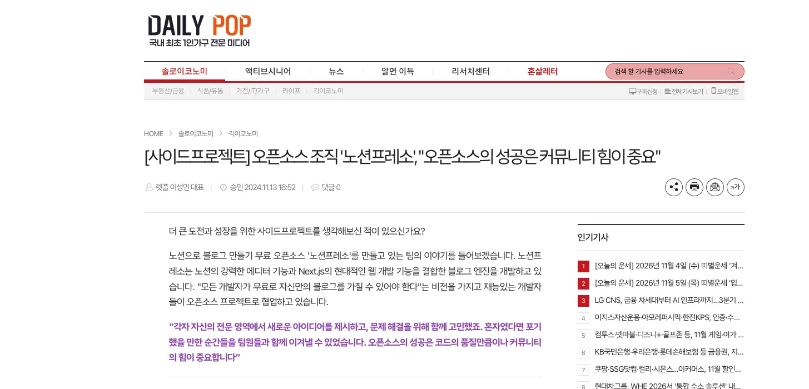
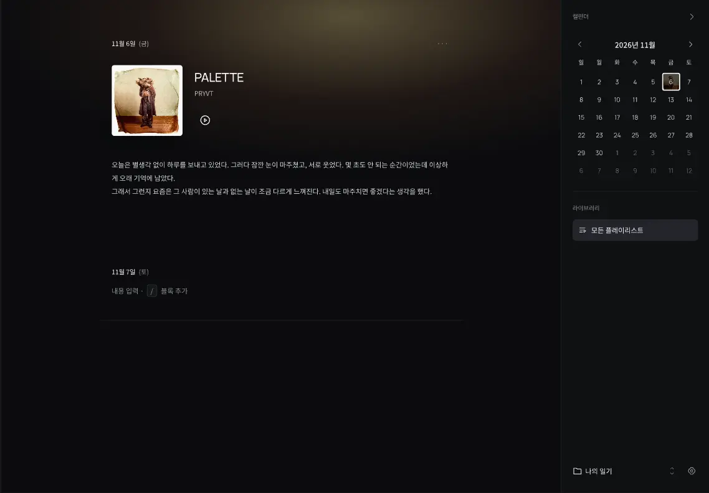
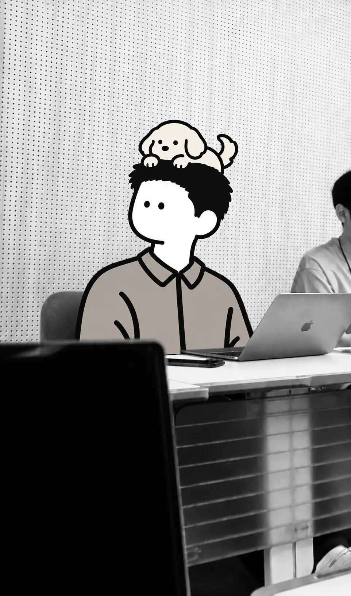

유치원 때 그림을 그려 국회의원상을 받은 적이 있다. 무슨 생각으로 그린 그림인지는 기억나지 않는다. 다만 모두 앞에 나가 상을 받았고, 그 자리에서 울었던 기억은 난다. 상장에 내 이름이 ‘정민영’이 아니라 ‘정민형’이라고 적혀 있었기 때문이다.

<figure>

<figcaption>2004년, 어린 시절.</figcaption>
</figure>

초등학교 때는 방과 후 수업에서 그림을 배우기도 했다. 하지만 막상 무엇을 그려야 할지 떠오르지 않았고, 결국 도망치듯 그만뒀다.

《임진록 2+ 조선의 반격》이라는 게임도 참 좋아했다. 형도 컴퓨터를 좋아해서 내가 게임을 할 수 있는 시간은 많지 않았다. 대신 역사 만화책을 자주 읽었다. 덕분인지 역사 시험은 따로 공부하지 않아도 곧잘 좋은 점수를 받았다.

운동도 좋아했다. 초등학교 때는 주로 축구 골키퍼를 맡았다. 공을 막으려고 자주 몸을 던졌는데, 친구들은 그런 나를 보고 돌고래 같다고 했다. 동아리 코치가 운동을 배워보지 않겠냐고 권한 적도 있었다.

중학교 1학년 때는 친구들과 야구를 하다가 야구부에 들어갔다. 외야를 넓게 뛰어다니며 공을 잡으려고 몸을 던졌다. 운동복이 더러워질수록 팀원들은 나를 더 믿어줬고, 나는 그 믿음이 좋았다.

<figure>

<figcaption>2013년, 야구를 하던 시절.</figcaption>
</figure>

야구를 하면서도 축구는 계속했다. 중학교 3학년 때도 골키퍼를 맡았다. 내가 뒤를 지켜주면 친구들은 더 적극적으로 공격에 나섰다.

반 대항전에서 우승했던 날이 기억난다. 경기가 끝나자 친구들이 내 주변으로 모여들었다. 지금도 그날을 떠올리면 기분이 좋아진다.

## 음악을 만들던 시절

열일곱 살 때 친구가 내게 힙합 음악을 들려줬다.

> “국힙이 근본이다.”

그렇게 소울컴퍼니의 《The Bangerz》와 이센스의 믹스테이프 《New Blood, Rapper Vol. 1》을 듣기 시작했다. 특히 이센스의 가사 중 이런 구절이 오래 기억에 남았다.

> 내 요람은 얼마짜리였을까?\
> 내 아들에게 더 좋은 걸 줄 수 있을까?\
> 사랑을 찾지 못했으니 아직은 먼 훗날\
> 내 아버지도 이러셨을까?

나도 언젠가 내 아이에게 더 좋은 것을 줄 수 있을까. 내 아버지도 나를 키우면서 이런 고민을 하셨을까. 음악을 들으면서 이전에는 생각해 보지 않았던 것들이 궁금해지기 시작했다.

자신의 이야기를 마음껏 펼치는 모습이 멋있었다. 시적인 표현도, 담백한 몇 마디도 좋았다. 그러다 보니 자연스럽게 더 많은 음악을 찾아 듣게 되었다.

생각해 보면 운이 좋았다. YouTube나 Spotify를 통해 세상 곳곳에서 누군가가 만든 음악을 작은 화면 하나로 쉽게 만날 수 있었으니까. J. Cole의 《4 Your Eyez Only》, Frank Ocean의 《Blonde》 같은 앨범들도 그렇게 알게 됐다.

그러다 보니 자연스럽게 앨범을 처음부터 끝까지 듣는 걸 좋아하게 됐다. 한 트랙에서 다음 트랙으로 이어지는 사운드와 각각의 이야기가 모여 하나의 앨범을 이루는 방식이 좋았다. 무엇보다 누군가의 이야기가 내게 전해지고, 그 음악을 통해 나 역시 오래된 기억을 떠올릴 수 있다는 게 좋았다.

음악을 듣다 보니 나도 직접 만들어보고 싶어졌다. 특별한 이유가 있었던 건 아니다. 그냥 나도 그러고 싶었다.

혼자 가사를 쓰고 녹음하기 시작했다. 열아홉 살에는 친구와 작업실을 함께 쓰며 번개곡을 만들기도 했다. 스무 살에는 그 친구가 유학을 떠났고, 나는 혼자 남아 아르바이트를 하면서 음악을 계속 만들었다.

<figure>

<figcaption>2017년, 자양동 작업실.</figcaption>
</figure>

그 무렵에는 친구들과 직접 갈등을 겪기도 했고, 친구들 사이의 갈등을 풀어야 하는 일도 많았다. 다른 사람의 이야기를 듣고 서로의 입장을 이해하려 애쓰다 보니, 정작 나 자신은 잘 돌보지 못했다. 남의 이야기를 듣는 일은 많았지만, 내 이야기를 들어줄 곳은 없다고 느꼈다.

그럴 때면 혼자 가사를 쓰고 녹음했다. 그날 있었던 일과 느꼈던 감정을 가사로 옮기고, 다시 들으며 곱씹었다. 음악은 그렇게 내 이야기를 내가 들어주는 방법이기도 했다.

하지만 곡을 다른 사람에게 들려주는 일은 쉽지 않았다. 사운드클라우드에 올렸다가 얼마 지나지 않아 지우곤 했다. 올리는 건 어려웠지만, 지우는 건 쉬웠다.

> 그때 지운 곡들이 아쉬워서 다시 녹음해 보기도 했지만, 그 시절의 목소리와 감정은 좀처럼 돌아오지 않았다.

대학에 진학하는 대신 아르바이트와 계약직 일을 하며 음악을 계속 만들었다. 언젠가는 잘될 거라고 믿었고, 그렇게 몇 년을 보냈다.

군대에 가면서 음악을 만드는 일도 잠시 멈추게 됐다. 그제야 그동안 음악을 해온 시간을 돌아보게 됐다.

나는 음악을 계속 만들면서도 정작 다른 사람에게 들려주는 일은 피하고 있었다. 언젠가는 잘될 거라는 믿음이 나를 움직이게 했지만, 어느 순간부터는 현실을 마주하지 않아도 되는 핑계가 되어 있었다. 처음에는 그저 좋아서 시작했던 음악인데, 어느새 만드는 즐거움에서도 조금씩 멀어지고 있었다.

## 웹을 만나다

전역 후에는 다시 아르바이트를 하며 지냈다. 그러다 2023년쯤 한 인터랙티브 개발자의 포트폴리오를 보게 되었다.

일상에서 얻은 영감을 웹에 표현한 작업들이었다. 무엇보다 인상적이었던 건 자신이 보고 느낀 것을 표현하는 데 주저하지 않았다는 점이었다. 다른 사람에게서 받은 영감을 그대로 재현하는 데 그치지 않고, 자신만의 표현으로 만들어내고 있었다.

나도 그렇게 만들어보고 싶었다. 그 개발자의 유튜브 영상을 찾아보며 하나씩 따라 하기 시작했다.

처음에는 화면에 보이는 코드를 똑같이 작성하면 같은 결과가 나올 거라고 생각했다. 하지만 생각처럼 되지 않았다. 분명 똑같이 작성했다고 생각했는데, 실제로는 다른 부분이 많았다. 무엇이 잘못되었는지 찾는 것조차 쉽지 않았다.

그런데도 계속 만들었다. 코드를 조금 바꾸면 화면이 달라졌고, 그 변화가 눈앞에 나타나는 게 좋았다.

부모님이나 친구에게 보여주기도 했다. 그때 어떤 반응을 보였는지는 잘 기억나지 않지만, 개발을 모르는 사람도 내가 만든 것을 직접 보고 경험할 수 있다는 사실이 좋았다.

그렇게 프론트엔드에 관심을 갖게 되었다.

## 나와 다른 사람들

혼자 개발하다 보니 같은 관심사를 가진 사람들을 만나고 싶어졌다. 그래서 부트캠프에 들어갔다. 하지만 막상 만나보니 생각보다 서로 달랐다. 각자 개발을 시작한 이유도, 이루고 싶은 목표도 달랐다.

그래서 좋았다. 서로 다른 생각을 나누고, 각자의 표현을 맞춰가는 과정이 좋았다. 내가 당연하게 생각했던 것을 다른 사람은 다르게 바라보기도 했다. 그런 차이를 마주하면서 내 부족한 부분을 발견하고, 조금씩 다듬어갈 수 있었다.

부트캠프에서 만난 동기가 함께 스타트업을 해보자고 제안한 적이 있다. 함께 일을 시작했지만, 시간이 지나면서 우리가 그 일에 걸고 있는 것이 다르다는 걸 알게 되었다. **그 친구는 자신의 삶을 걸고 있었고, 나는 내 시간을 걸고 있었다.** 그 차이를 알게 되었을 때 미안했고, 부끄러웠다. 결국 함께하던 일에서 나왔다.

그 이후로는 누군가 함께 일하자고 할 때 그 일이 무엇인지보다 왜 하려는 일인지 먼저 생각하게 되었다. 상대방은 무엇을 이루고 싶은지, 나는 왜 함께하려는지, 그리고 서로 무엇을 기대하고 있는지.

같은 일을 한다고 해서 같은 마음으로 시작하는 건 아니었다. 그때부터 무언가를 시작하기 전에 조금 더 많은 것을 생각하게 된 것 같다.

사람들과의 관계뿐 아니라, 함께 코드를 만드는 일도 쉽지 않았다. 노션프레소라는 오픈소스 프로젝트에 참여하면서 이미지 뷰어를 만들었다. 브라우저마다 다르게 동작하는 부분이 있었고, 컴포넌트가 마운트되는 시점이나 상태에 따라 예상하지 못한 오류가 발생하기도 했다. 하나를 수정하면 또 다른 문제가 보였다.

다른 사람이 작성한 코드를 이해하는 일도 어려웠다. 왜 이렇게 작성했는지, 어디에 연결되어 있는지, 수정하면 다른 부분에 어떤 영향을 미치는지. 코드 하나의 의미를 이해하려면 그 주변의 구조까지 함께 살펴봐야 했다. 계속 어려웠지만 계속 들여다봤고, 그러다 보니 조금씩 구조가 보이기 시작했다.

<figure>

<figcaption>2024년, 노션프레소를 소개한 기사.</figcaption>
</figure>

## 지금 만들고 있는 것들

다른 사람들과 함께 무언가를 만드는 일은 여전히 낯설고 어렵지만, 그만큼 재미있다. 그러다 문득 내가 정말 필요하다고 느끼는 것을 직접 만들어본 적이 있을까 하는 생각이 들었다.

평소 일기를 쓸 때면 그날 인상 깊게 들었거나 기분과 어울리는 음악을 함께 기록하곤 했다. 이 두 가지를 한곳에서 더 편하게 기록할 수 있으면 좋겠다는 생각에 Interlude를 만들기 시작했다.

<figure>

<figcaption>2026년, 음악 일기 앱 Interlude.</figcaption>
</figure>

가끔은 빈 페이지 앞에서 무엇부터 써야 할지 막막했다. 생각나는 대로 적어놓은 글을 다시 정리하는 일도 부담스러웠다. 기록하는 일이 조금 더 편했으면 했다.

그리고 시간이 지나 그날의 음악을 다시 들었을 때, 당시의 감정과 생각도 함께 떠올릴 수 있으면 좋겠다고 생각했다. 지난날을 돌아보며 후회할 때도 있겠지만, 그때의 자신을 조금 더 이해하고 덜 아파할 수 있기를 바랐다.

## 남겨두고 싶은 것들

<figure>

<figcaption>2026년, 지금의 나.</figcaption>
</figure>

개발을 하면서 Git의 커밋 이력이 좋아졌다. 코드를 수정할 때마다 이전의 선택이 기록으로 남고, 시간이 지나 다시 살펴보면 그때는 보이지 않았던 것들이 보이기도 한다.

물론 여전히 다른 사람의 시선은 신경 쓰인다. 부족했던 모습을 어떻게 바라볼지 걱정되기도 한다.

하지만 예전에 지워버린 음악들을 생각하면, 그런 모습도 남겨두고 싶어진다. 그때는 마음에 들지 않았던 곡들이 지금은 다시 들을 수 없는 기록이 되었으니까.
